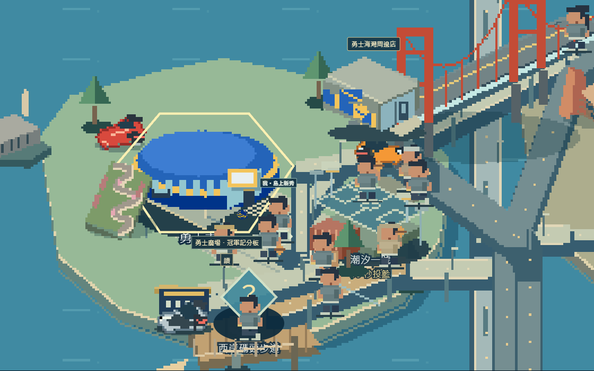
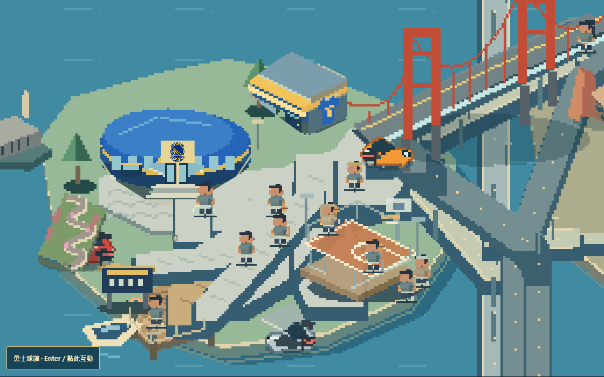
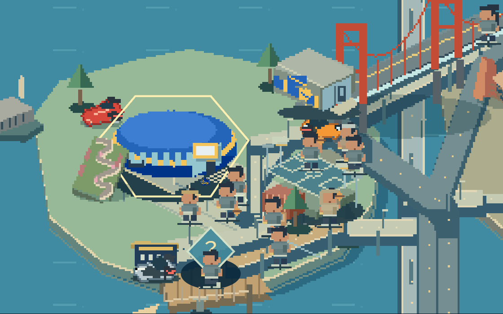
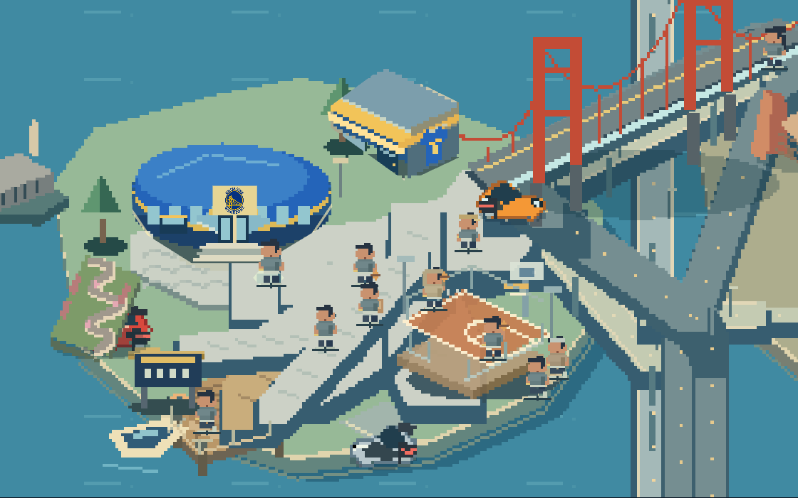

# 勇士海灣：橋頭分流與無標籤辨識

本次精修勇士島。30 隊、15 場遊戲、地標 ID、邀請連結與本機收藏鍵保留。沒有推送、部署或修改 Supabase。

## 實際前後截圖

改版前讀取 Git `2565ad0`，兩版使用相同 1440 × 1000 視窗、相同世界框 `(65,325,520,325)`、白天與減少動態設定；地圖截圖為 1120 × 700 CSS px。舊版也套用相同鏡頭範圍，不移動舊物件。這些是本機頁面截圖，並非美術合成圖。

| 改版前 | 改版後 |
| --- | --- |
|  |  |
|  |  |

[夜間](./warriors-bay-preview/after-night.png)／[390px 手機夜間模擬](./warriors-bay-preview/after-mobile-night.png)／[NPC 第四張觀察畫面](./warriors-bay-preview/npc-3.png)。實機手機、不同瀏覽器及個人辨識仍需手動確認。

## 修改位置

| 檔案 | 改動 |
| --- | --- |
| `assets/archipelago-core.js` | `BAY` 集中配置、鏡頭、24 單位玩家、7 單位腳底半徑、48 單位主步道、碰撞體、互動半徑及點擊多邊形；`SHOP_PLACES` 提供共用店門座標 |
| `assets/warriors-bay-art.cjs`、`archipelago-art.cjs` | 獨立石磚廣場、分流步道、木棧道、繫船柱、船、邊緣長椅、燈光及停車區 |
| `assets/pixel-core.js` | 低矮藍色橢圓球館、朝鏡頭的門廳與階梯；`harbor-01` 專屬橘色半場、罰球弧、單一籃框及圍網缺口 |
| `assets/shop-art.cjs`、`assets/shops/shop-warriors*.svg` | 黃遮雨棚、門窗、店外藍色球衣道具；不更改玩家球衣 |
| `assets/explorer-core.js`、`explorer-ui.js` | 腳底淨空路徑、最近互動目標、抵達／離開提示、固定灣區構圖；沿用一個動畫迴圈 |
| `script.js`、`assets/shop-ui.js` | 點擊區貼合物件輪廓，保留原滑鼠與鍵盤入口 |
| `assets/team-logo.css` | 修正隊徽偏離看板的排版，保留原圖比例與透明背景 |
| `assets/bay-scene.js`、`bay.css`、`warriors-bay.css` | 10 名 NPC 路線、邊緣停留、玩家讓行、小型定位菱形及單一操作提示 |
| `assets/traffic-core.js` | 停放車移出碼頭通道及船身前方；兩條巡遊線保留 |
| `assets/generate_pixel_assets.cjs`、`assets/pixel/` | 重建球館、地面、道路、燈光、前景、道具；新增專屬半場日夜 PNG／SVG，清單共 188 組 |
| `tests/` | 灣區配置、碰撞、熱區、提示、相機、NPC、新舊 UI 及素材回歸 |

## 驗證紀錄

執行結果見 [Node 回歸](./warriors-bay-preview/node-tests.txt)、[靜態檢查](./warriors-bay-preview/static-checks.txt)、[本機頁面驗收](./warriors-bay-preview/verification.json)。

最終結果：**264 項 Node 測試通過、52 個 JS／CJS 語法通過、13 份 CSS 結構與 188 組 PNG／SVG 路徑及像素檢查通過**。`git diff --check` 通過。這些測試不等於真人連線或實機觸控驗收。

- Node 覆蓋球隊／遊戲 ID、路網、舊資料、賽況、售票、商店、合影、輪替及動畫清理。新增測試逐段採樣步道，將腳底半徑納入淨空，檢查球館與商店的像素／點擊多邊形不重疊。
- 本機以 `/nba-policy-island/` 路徑載入並封鎖外部請求。實際操作四入口鍵盤抵達、正確資訊與提示；帽子加入購物車為 120 島幣；投籃試玩、正式出手及返回；學生保留席為 2,400 點。
- 啟用動畫，從紅橋側步道走到四入口；移動時提示收起，採樣玩家腳底無碰撞，回全島保留位置。
- 另以 `file://` 直接開啟頁面，實際點擊四個模型熱區（包含從商店直接點碼頭），完成一整局 30 秒投籃：命中 3 球，倒數歸零、停止出手並可回球場。見 [滑鼠與結算紀錄](./warriors-bay-preview/mouse-acceptance.json)、[結算截圖](./warriors-bay-preview/tidal-result.png)。
- 固定構圖觀察 28 秒 NPC，每 7 秒存一張圖。日夜保留角色位置；勇士主場 LIVE 切完賽停止脈動，夜間道路照明保留。
- 未執行真人雙裝置、實機手機、全部 15 款逐一目視、PNG 下載或遠端 Supabase 驗收，不列為本次通過。

## 手動展示

1. 本機開啟 `index.html`，區域選單選「金州勇士島」。辨識藍屋頂與門上隊徽、橘色半場與籃框、黃棚藍衣商店、木棧道和船。
2. 從金門橋觀景點依序點球館、球場、商店與碼頭。確認沿路移動、抵達才開資訊、最多一個設施提示。關閉面板後可用提示按鈕或地圖 Enter 再開。
3. 售票試算學生保留席、半場開始試玩、商店加入商品。回全島再拉近，角色仍在原處。
4. 切日夜，選勇士主場模擬，從 LIVE 切完賽；確認道路和場線清楚，觀察 NPC 經過入口的遮擋。

重建順序：`node assets/shop-art.cjs` → `python assets/generate_pixels.py` → `node assets/generate_fan_assets.cjs`。最後一步需在像素生成後執行，才能同步偶遇衍生 SVG。

`tests/preview-warriors.cjs` 和 `tests/preview-warriors-mouse.cjs` 不在一般 Node 測試內；只在明確允許畫面驗收時執行。`PLAYWRIGHT_MODULE` 指向本機已安裝 Playwright，`CHROME_PATH` 指向測試用 Chrome。工具不下載依賴、不登入、不讀個人瀏覽器設定或存取外部服務。
